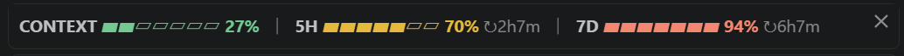

# usage-bar

Claude Code 입력창 위에 컨텍스트 사용량과 5시간·일주일 한도를 색 게이지 한 줄로 보여 주는 플러그인이에요.

A Claude Code plugin that shows context usage and the 5-hour and 7-day limits as one line of colored gauges above the prompt.



## 왜 만들었나

Claude를 쓰다 보면 한도가 얼마나 남았는지 보려고 작업을 멈추게 돼요. 이 패널은 대화 중에 필요한 숫자를 계속 보여 줘요.

## 보여 주는 것

| 항목 | 뜻 |
|---|---|
| `CONTEXT` | 지금 대화가 쓰는 컨텍스트 비율 |
| `5H` | 5시간 한도 사용률과 초기화까지 남은 시간 |
| `7D` | 일주일 한도 사용률과 초기화까지 남은 시간 |

| 사용률 | 색 |
|---|---|
| 50% 미만 | 초록 |
| 50~79% | 노랑 |
| 80% 이상 | 빨강 |

## 설치

Claude Code 터미널에서 실행해요.

```text
/plugin install usage-bar --marketplace Serraim/usage-bar
```

또는 셸에서 실행해요.

```bash
claude plugin install usage-bar --marketplace Serraim/usage-bar
```

패널은 세션이 시작될 때 열려요. 닫은 뒤에는 `/usage-bar`로 다시 열 수 있어요.

한도 값은 Claude Code가 제공할 때만 나와요. 제공되지 않으면 `-`로 표시돼요.

## 패널 폭 맞추기

게이지 칸 수는 `usage-bar/hooks/register.tsx`의 `CELLS`로 정해요. 한 줄에 안 들어가면 값을 줄이고, `/reload-plugins`를 실행해요.

## 선택 사항: VS Code 패널 윗줄 숨기기

VS Code에서는 패널 위에 플러그인 이름과 제목 줄이 나와요. 플러그인 설정으로는 숨길 수 없어서, 이 줄을 숨기는 스크립트를 따로 넣어 뒀어요.

```bash
python tools/hide_pane_header.py
```

그다음 VS Code에서 `Developer: Reload Window`를 실행해요. 되돌릴 때는 아래 명령을 써요.

```bash
python tools/hide_pane_header.py --undo
```

**공식 기능이 아니에요.** 이 스크립트는 설치된 Claude Code 확장의 `webview/index.css`를 직접 고쳐요. 처음 실행할 때 원본을 `index.css.usage-bar-backup`으로 저장해요. 확장이 업데이트되면 파일이 교체되므로 다시 실행해야 하고, 내부 이름이 바뀌면 스크립트를 고쳐야 할 수 있어요. 다른 플러그인 패널의 윗줄도 같이 숨겨져요. 플러그인은 이 스크립트 없이도 작동해요.

## 확인한 환경

Windows 10의 VS Code 확장과 Claude Code 2.1.318에서 사용해 봤어요. 다른 환경에서는 시험하지 않았어요.

## 라이선스

[MIT](LICENSE)
